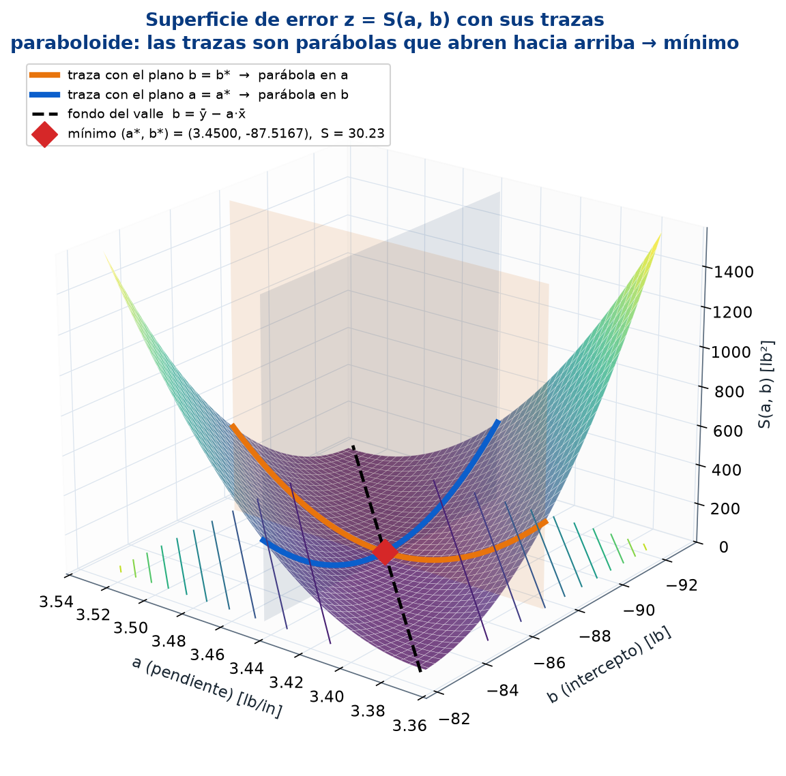
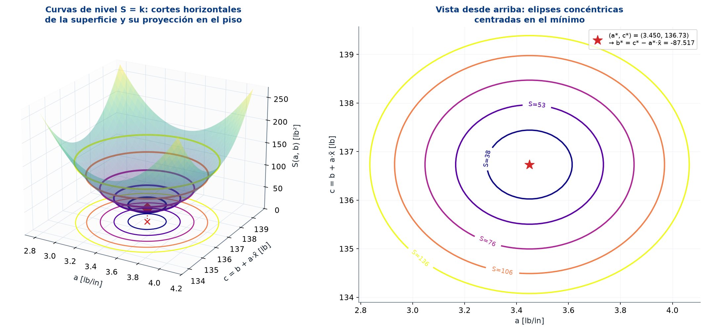
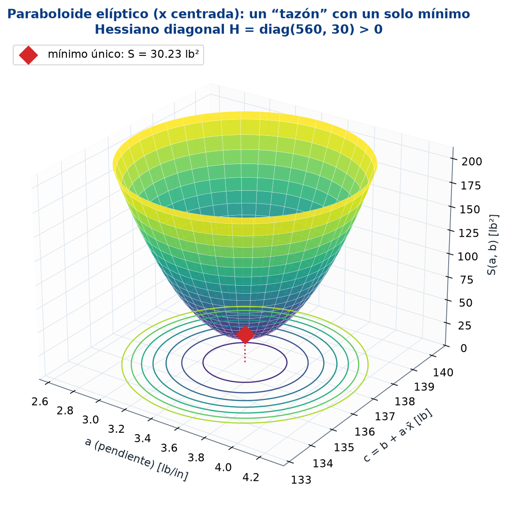
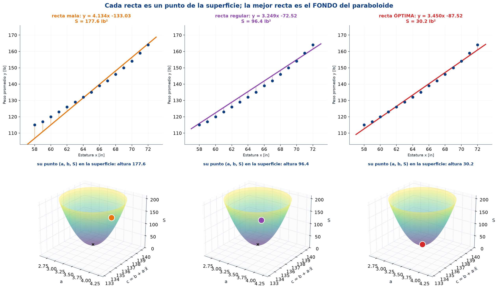
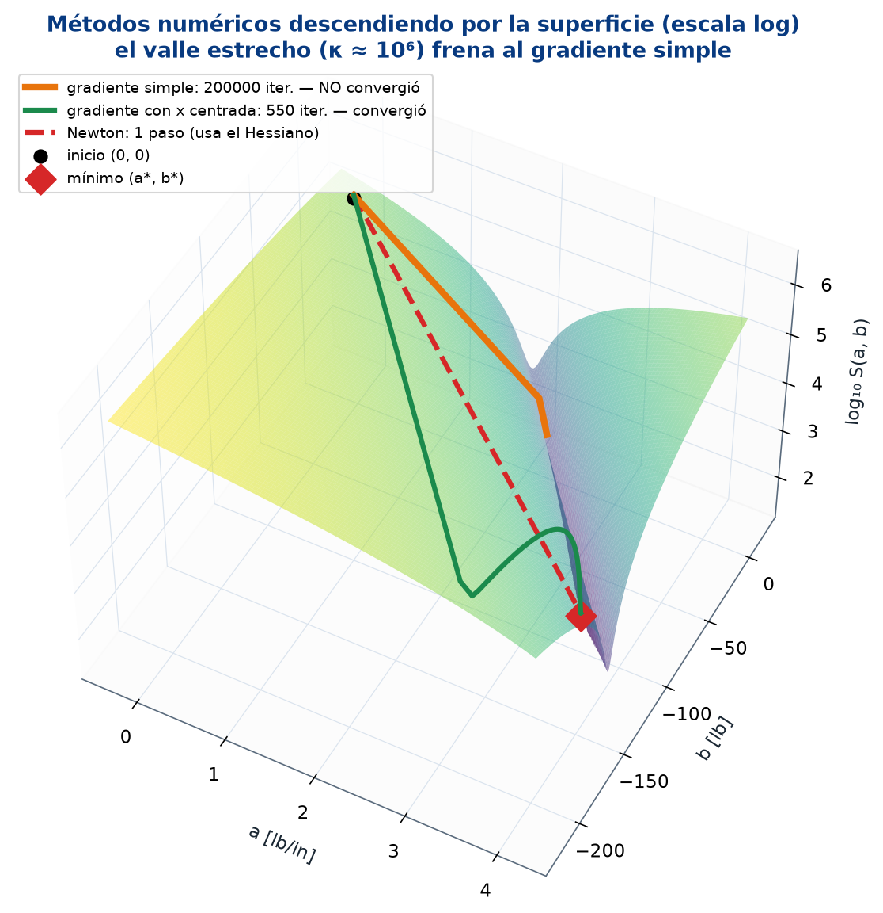
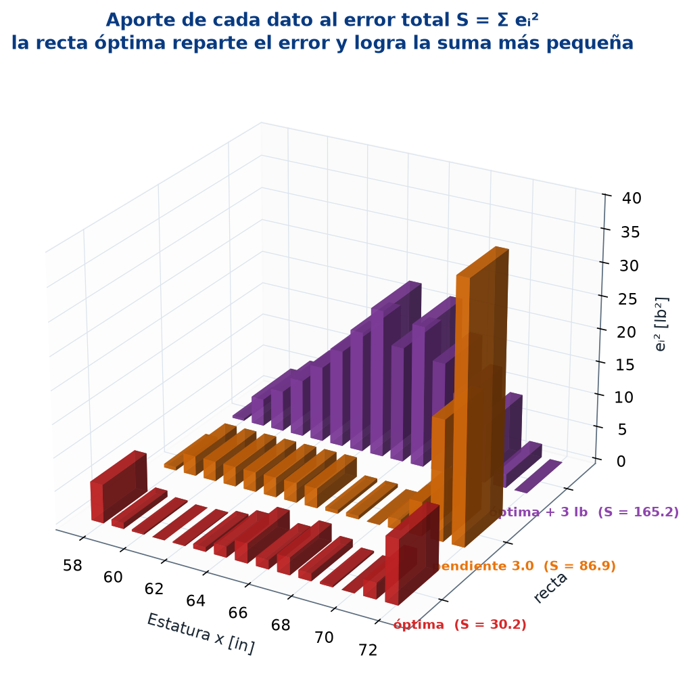

# Proyecto de Cálculo Multivariable — Regresión lineal y optimización

**Pregunta central:** ¿cómo se puede utilizar el Cálculo Multivariable para determinar y analizar
el modelo lineal que mejor representa un conjunto de datos?

**Problema real:** estatura (in) vs. peso promedio (lb) de mujeres estadounidenses de 30–39 años
(15 datos, *World Almanac* 1975). Ver [`FUENTE.md`](hyperframes-studio/data/input/FUENTE.md).

**Resultado:** ŷ = 3.45·x − 87.5167, S_mín = 30.2333 lb², R² = 0.991, RMSE = 1.42 lb.

## App interactiva (`results/html/app.html`)

Un solo archivo que funciona **sin internet**: hay que descargarlo y abrirlo con doble clic. Tiene 9 vistas
enlazadas: 1 Datos editables (CSV, excluir puntos), 2 Desarrollo analítico paso a paso con los valores
manuales, 3 Explorador (controles a y b junto con las curvas de nivel), 4 Superficie 3D (planos de corte,
trazas, valle, descenso por gradiente, escala log, x centrada, cámaras), 5 Trazas, 6 Hessiano,
7 Residuos, 8 Tabla §9 y 9 Análisis adicional A–D.

Python calcula los resultados oficiales; el navegador recalcula con las mismas fórmulas
(`web/regresion.js`). La insignia verde confirma que ambos coinciden. Para regenerarla:
`python src/app_html.py` (o `python src/main.py`).

Explicación completa de la app (variables, ecuaciones, métodos y las cuatro gráficas 3D):
[`docs/guia_app.md`](hyperframes-studio/docs/guia_app.md).

## Para la sustentación

- 🎤 **Presentación interactiva:** `hyperframes-studio/results/html/presentacion.html`. Hay que
  descargarla y abrirla en el navegador; funciona sin internet. Tiene 24 diapositivas organizadas
  según los criterios de evaluación (cada una indica qué criterio cubre), la solución paso a paso,
  superficies 3D que se pueden girar, un explorador con deslizadores, notas para el expositor
  (tecla **N**) y práctica de preguntas con una pregunta aleatoria. Teclas: ← → para avanzar,
  **I** para el índice y **F** para pantalla completa. Para poner sus nombres, editen
  `INTEGRANTES` en `src/presentacion.py` y ejecuten `python src/presentacion.py`.
- 🧊 **Modelos 3D interactivos:** abrir `hyperframes-studio/results/html/modelos_3d.html` en el
  navegador (funciona sin internet). Superficie con trazas y curvas de nivel, el "tazón" con x
  centrada, un **explorador** que mueve la recta y su punto sobre la superficie, y los métodos
  numéricos en 3D.
- ❓ **Preguntas probables y respuestas:** `hyperframes-studio/docs/guia_sustentacion.md`.

## Gráficas 3D

**Superficie de error z = S(a, b) con sus trazas.** Es un paraboloide: las trazas son parábolas que
abren hacia arriba y el mínimo (rombo rojo) es la recta óptima.



**Curvas de nivel en 3D.** Son cortes horizontales de la superficie: elipses concéntricas centradas
en el mínimo.



**Paraboloide elíptico con x centrada.** Es la misma función vista como un “tazón” con un solo mínimo.



**Cada recta es un punto de la superficie.** La mejor recta es el fondo del paraboloide.



**Métodos numéricos bajando por la superficie.**



**Aporte de cada dato al error total S = Σeᵢ².**



La versión **interactiva**, que se puede girar y tiene un explorador animado, está en
`hyperframes-studio/results/html/modelos_3d.html`. Para verla hay que descargarla y abrirla en el
navegador, porque GitHub no muestra archivos HTML.

## Dónde está cada parte del enunciado

| Sección del enunciado | Documento / figura |
|---|---|
| §5 Exploración de datos | `docs/calculo_manual.md` §1–2, `01_dispersion.png` |
| §6 Construcción del modelo | `docs/planteamiento.md` |
| §7.1–7.4 Derivadas, ∇S = 0, solución, Hessiano (a mano) | `docs/calculo_manual.md`, `docs/desarrollo_matematico.md` |
| §7.5–7.8 Superficie, trazas, curvas de nivel | `docs/interpretacion_geometrica.md`, figuras `03`–`05` y `12`–`17` (3D), `results/html/modelos_3d.html` |
| §8 Verificación computacional | `src/` y `docs/analisis_resultados.md` §8 |
| §9 Tabla analítico / código propio / biblioteca | `docs/analisis_resultados.md` §9 |
| §10–12 Recta, residuos, calidad | `docs/analisis_resultados.md`, figuras `02`, `06`, `07` |
| §13 Análisis adicional (A, B y C) | `docs/analisis_resultados.md` §13, figuras `10`, `11` |
| Conclusiones | `docs/Conclusiones.md` |
| Pseudocódigo y diagrama de flujo | `docs/pseudocodigo.md` |

Las figuras están en `hyperframes-studio/results/images/`.

## Cómo ejecutar

```bash
cd hyperframes-studio
python -m pip install numpy matplotlib scipy plotly openpyxl imageio imageio-ffmpeg pillow
python src/main.py --sin-gui     # todo el análisis + results/
python tests/pruebas.py          # 21 pruebas automáticas
```

`src/generar_datos.py` solo crea datos **sintéticos** para pruebas (`datos_sinteticos.csv`).
No modifica los datos reales.
