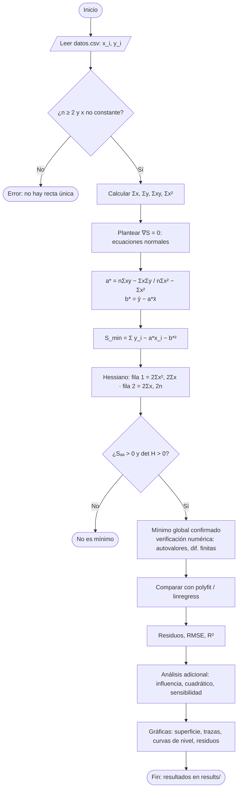

# Pseudocódigo y diagrama de flujo (criterio "Programación y lógica")

## Relación código ↔ modelo matemático

| Concepto matemático | Fórmula | Función en el código |
|---|---|---|
| Modelo | ŷᵢ = a·xᵢ + b | `modelo.prediccion` |
| Función de error | S(a,b) = Σ(yᵢ − axᵢ − b)² | `modelo.error_cuadratico` |
| Gradiente | ∇S = (−2Σxᵢeᵢ, −2Σeᵢ) | `derivadas.gradiente` |
| Punto crítico ∇S = 0 | ecuaciones normales | `analitico.resolver_analitico` |
| Hessiano | H = [[2Σx², 2Σx], [2Σx, 2n]] | `derivadas.hessiana` |
| Criterio del Hessiano | Sₐₐ > 0 y det H > 0 | `derivadas.verificar_minimo` |
| Verificación numérica de H | diferencias finitas, autovalores | `analisis.verificar_hessiano_numerico` |
| Comparación con biblioteca | `polyfit`, `linregress` | `analisis.comparar_metodos` |
| Residuos, RMSE, R² | eᵢ = yᵢ − ŷᵢ | `analisis.analizar_residuos`, `analisis.calidad_ajuste` |

## Pseudocódigo del ajuste (lo que se dedujo a mano)

```
ALGORITMO MinimosCuadrados
ENTRADA: lista de pares (x_i, y_i), i = 1..n
SALIDA:  a*, b*, S_min, H, ¿es mínimo?

1.  LEER datos desde datos.csv
2.  SI n < 2 O todos los x_i son iguales ENTONCES
        ERROR "no existe una recta única"
3.  Sx ← 0; Sy ← 0; Sxy ← 0; Sxx ← 0
4.  PARA i ← 1 HASTA n HACER
        Sx  ← Sx  + x_i
        Sy  ← Sy  + y_i
        Sxy ← Sxy + x_i · y_i
        Sxx ← Sxx + x_i²
    FIN PARA
5.  D ← n·Sxx − Sx²                       // = det(H) / 4
6.  a* ← (n·Sxy − Sx·Sy) / D              // de ∇S = 0
7.  b* ← (Sy − a*·Sx) / n
8.  S_min ← 0
    PARA i ← 1 HASTA n HACER
        e_i ← y_i − (a*·x_i + b*)         // residuo
        S_min ← S_min + e_i²
    FIN PARA
9.  H ← [[2·Sxx, 2·Sx], [2·Sx, 2·n]]
10. SI H[1,1] > 0 Y det(H) > 0 ENTONCES
        es_minimo ← VERDADERO             // H definida positiva
11. RMSE ← raiz(S_min / n)
    R²   ← 1 − S_min / Σ(y_i − ȳ)²
12. COMPARAR (a*, b*, S_min) con polyfit / linregress
13. GRAFICAR dispersión, recta, superficie, trazas, curvas de nivel, residuos
FIN
```

## Pseudocódigo del descenso por gradiente (complemento numérico)

```
ALGORITMO DescensoGradiente(a0, b0, η, tol, max_iter)
1.  (a, b) ← (a0, b0)
2.  REPETIR k = 1, 2, ..., max_iter
        g_a ← 2·(a·Sxx + b·Sx − Sxy)      // ∂S/∂a
        g_b ← 2·(a·Sx  + n·b  − Sy)       // ∂S/∂b
        SI raiz(g_a² + g_b²) < tol ENTONCES TERMINAR (convergió)
        a ← a − η·g_a
        b ← b − η·g_b
3.  DEVOLVER (a, b)
// Newton: (a, b) ← (a, b) − H⁻¹·∇S   → llega al mínimo en 1 paso porque S es cuadrática
```

## Diagrama de flujo


